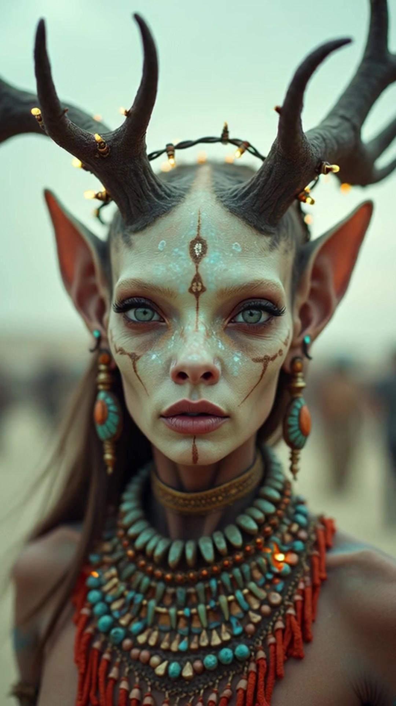
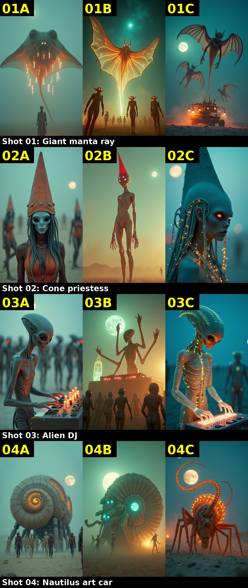
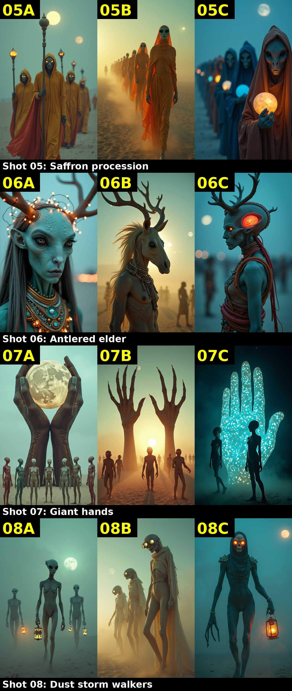
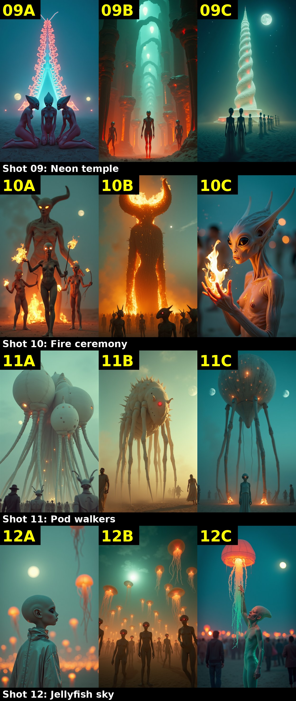

# Riffing on an Alien Burning Man Video With Only My Home GPU

I saw [a video I loved](https://www.instagram.com/reel/Dd2ggMHRIkO/). Forty-eight seconds, vertical, alien priests on a hazy playa, with a dark, hypnotic soundtrack at about 85 BPM. Burning Man if the camp were from another planet.

So I asked ComfyUI Local, my Grok Bot that drives ComfyUI, to riff on it. One rule: local models only. Everything renders on Roux, my 4090 box at home. No cloud generation APIs.

Last time I did this it was [a Zappa video](/2026/08/local-gpu-video-with-grokbot/). This time the bar was a video I already liked.

## The cast

A few names come up a lot, so here's who's who.

**Roux** is my Linux box. It lives in a closet and normally does boring jobs: DNS, cameras, backups. It has a **[GeForce RTX 4090](https://www.nvidia.com/en-us/geforce/graphics-cards/40-series/rtx-4090/)** in it, Nvidia's top-of-the-line consumer graphics card from 2022, about $1,600. Most people buy one to run video games at insanely high frame rates. A graphics card's specialty is doing thousands of tiny math problems at the same time, which also happens to be exactly what AI image and video generation needs. So the same card that shreds Call of Duty can, it turns out, double as a little AI movie studio.

**[ComfyUI](https://www.comfy.org/)** is free software that runs on that card. Think of it as a workbench where you snap together image and video generation models like Lego. **ComfyUI Local** is a bot — an AI agent I talk to in plain English — that drives that workbench for me. I say "riff on this video," it does the clicking.

The models it runs, all sitting on Roux's disk, no cloud involved:

- **[Flux Dev](https://blackforestlabs.ai/models/)** paints pictures from a written description. Give it "a manta ray made of lanterns" and twenty seconds later you have the still.
- **[Wan 2.2](https://github.com/Wan-Video/Wan2.2)** makes those stills move. Feed it one image, it guesses the next few seconds of motion. Video is much harder than stills, which is why each clip takes minutes, not seconds.
- **[Stable Audio Open](https://stability.ai)** generates music from a text prompt.
- **[ffmpeg](https://ffmpeg.org/)** is old-school video software (predates the AI craze by decades) that stitches the clips together, cuts on the beat, and scales everything up.

There's also **the bot's brain**: the agent itself runs on cloud-hosted language models. So the *thinking* happens in a datacenter, but every *pixel and note* was made at home on the 4090. That's the whole point of the exercise.

## Step 1: watch the source

The bot pulled frames and the audio and wrote down what makes it work. Teal-grey playa haze. Alien priests in tall headdresses. Crimson processions. Giant moons. Pod creatures walking on insect legs. Shots of 3 to 6 seconds, cut to the beat.

Not a copy. A palette.

## Step 2: twelve new scenes

From that palette it wrote 12 shots:

- a manta ray made of lanterns
- a priestess in a cone headdress
- an alien DJ on a modular synth
- a nautilus art car that walks
- a saffron procession
- an antlered elder
- giant metal hands
- figures in a dust storm
- a neon temple
- fire dancers and a burning effigy
- pod walkers over a crowd
- a cloaked child under jellyfish lanterns

## Step 3: stills, then motion

Flux Dev made the stills at 720x1280, about 12 to 15 seconds each.

Then Wan 2.2 image-to-video, the 14B model with the 4-step lightx2v speedup, turned each still into motion: 480x832, 81 frames, about 78 seconds per clip on the 4090.

## Step 4: music

Stable Audio Open made a brand-new soundtrack, locally.

I like the original music much better. Not close. The local track is fine. The original has a pulse the local one doesn't. Local video is getting good. Local music isn't there yet.

## Step 5: the edit

ffmpeg cut the clips on the beat and upscaled to 1080x1920.

<video controls playsinline preload="metadata" poster="/assets/promtgenix-riff-poster.jpg" width="360" style="max-width:100%;height:auto"><source src="/assets/promtgenix-riff.mp4" type="video/mp4"></video>

The music is the original soundtrack from [the source reel](https://www.instagram.com/reel/Dd2ggMHRIkO/). Video concept and soundtrack credit go to its creator, [promptgenix](https://linktr.ee/promptgenix). The visuals in my cut are new, rendered locally.

## Verdict

Great start. Honest list of what's wrong:

- It's softer than the source. The motion renders at 480p and gets upscaled, and you can see it.
- Some shots are too human. The source feels alien all the way through.
- The motion is gentle. The source moves more.

## v2: three takes of every shot

So I asked for more options. Three takes of each of the 12 shots, 36 Flux Dev stills at 832x1472. About 20 seconds each, about 12.5 minutes total.

Each take got a different light:

- A: soft overcast twilight
- B: golden backlit dust, wide
- C: blue-hour bioluminescent, telephoto

The prompts also pushed harder on beings that are clearly not human.

My picks: 01B (with the vehicle from 01C merged in), 02A, 03C, 04C, 05C, 06A, 07C, 08C, 09A, 10A, 11B, 12C. Blue hour took half.

Here is v2. The 01 pick is 1B with the 1C vehicle merged in via Flux Kontext. Each pick was animated with Wan 2.2 I2V 14B at 720x1280, 81 frames at 16fps. About 4 minutes per clip on the 4090. The cuts are aligned to the track's downbeats with librosa. Same original promptgenix soundtrack, credited above.

<video controls playsinline preload="metadata" poster="/assets/promtgenix-riff-v2-poster.jpg" width="360" style="max-width:100%;height:auto"><source src="/assets/promtgenix-riff-v2.mp4" type="video/mp4"></video>
